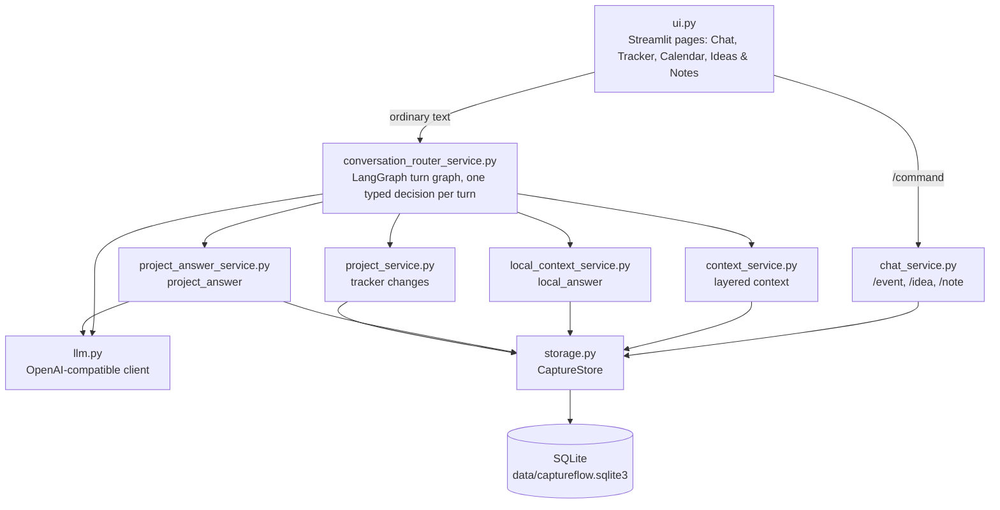

# CaptureFlow

CaptureFlow is a local, single-user project continuity assistant. Its interface is
persisted text chat: it keeps bounded conversation context and maintains
source-grounded local records in SQLite — Calendar events, Ideas & Notes, and
per-project tracker records such as tasks, decisions, and blockers. The default
workspace keeps chat beside a snapshot of the selected project, where open tasks,
blockers, and questions can be checked off and upcoming items open their day in
Calendar. Tracker groups records by type with per-record details, Calendar is a
month grid with a day agenda, and Ideas & Notes is a searchable card view. The
sidebar holds only navigation, the project filter, and its conversation list;
project and conversation settings live in the chat header. Deleting a
project removes its tracker state and audit links but keeps its conversations,
messages, calendar events, ideas, and notes as unassigned local records.

It is deliberately not a general chatbot. On each ordinary chat turn one model
call reads the message in its bounded conversation context and returns a typed
decision; only a question about a whole project makes a second call. The turn runs
as a LangGraph state graph whose nodes are those steps. Python
validates the candidate target, time policy, lifecycle, duplicate/conflict, and
credential rules before any SQLite write. The working principle is: understanding
belongs to the model; authorization stays in Python.
It has no external calendar synchronization, email, meetings, vector retrieval,
or access to external services.

## Project structure

CaptureFlow is a Python 3.11 package (`src/captureflow`) with a Streamlit front
end, Pydantic models, SQLite storage, a LangGraph graph for each chat turn, and an
OpenAI-compatible model client. It
is organized in layers. Services never import the UI, and only `storage.py` and
`migrations.py` touch SQLite:



| Layer | Modules | Responsibility |
| --- | --- | --- |
| Presentation | `ui.py`, `app.py` | Streamlit pages and widgets. Chooses the command service or the router for each message and renders records, source cards, and Undo. |
| Turn handling | `conversation_router_service.py`, `chat_service.py` | Turns one user message into at most one validated write, or a reply. |
| Understanding and answers | `context_service.py`, `llm.py`, `local_context_service.py`, `project_answer_service.py`, `project_service.py` | Builds the model's context, makes the model call, answers questions, and checks proposed tracker changes. |
| Persistence | `storage.py`, `migrations.py`, `models.py` | Typed records, schema migrations, and audited, restart-safe writes to SQLite. |
| Shared helpers | `credentials.py`, `date_tool.py`, `time_config.py` | Credential detection, the calendar reference table, and configured local time. |

### Repository layout

```text
captureflow/
├── app.py                          # Streamlit entry point; calls captureflow.ui.main()
├── pyproject.toml                  # Package metadata and dependencies
├── .streamlit/config.toml          # Streamlit theme
├── src/captureflow/
│   ├── ui.py                       # All pages, the sidebar, and chat input dispatch
│   ├── conversation_router_service.py  # The contextual router's LangGraph graph: model decision → policy → write
│   ├── chat_service.py             # Model-free /event, /idea, /note commands and reply-only turns
│   ├── context_service.py          # Recent conversation and one-line stored state for the model
│   ├── llm.py                      # ModelSettings, the OpenAI-compatible client, and its prompts
│   ├── local_context_service.py    # Answers about specific events, ideas, notes, or records
│   ├── project_answer_service.py   # Project snapshot and the second model call for project questions
│   ├── project_service.py          # Validates tracker changes and commits those needing no review
│   ├── models.py                   # Pydantic models: records, operations, ConversationDecision
│   ├── storage.py                  # CaptureStore: every SQLite read and write
│   ├── migrations.py               # Ordered, versioned schema migrations
│   ├── credentials.py              # Deterministic credential-disclosure check
│   ├── date_tool.py                # Calendar reference table and dates named in questions
│   └── time_config.py              # CAPTUREFLOW_TIMEZONE and the reference "now"
├── tests/                          # unittest suite, one file per module
│   └── fixtures/                   # Frozen Phase 9 and Phase 10 acceptance cases
├── scripts/
│   ├── run_local_app.ps1           # Starts Streamlit from this checkout with Qwen defaults
│   └── run_phase10_live_acceptance.py  # Live acceptance run against a real model
└── docs/                           # Phase designs, evidence, and migration notes
```

Ignored local directories: `data/` holds the SQLite database, and `runs/` and
`artifacts/` hold acceptance traces.

### Data model

`models.py` defines the Pydantic types, and `migrations.py` creates the matching
tables. The database applies every pending migration when `CaptureStore` opens it.

| Area | Tables | Contents |
| --- | --- | --- |
| Conversation | `conversations`, `messages` | Persisted chat, including failed and blocked turns |
| Calendar | `calendar_events`, `calendar_event_sources`, `calendar_event_update_operations`, `calendar_event_update_sources` | Local events, the messages they came from, and reviewable, undoable updates |
| Ideas & Notes | `saved_items` | Ideas and notes with their source message |
| Projects | `projects`, `conversation_projects`, `project_records`, `project_record_events`, `project_conversation_state` | Tracker records (tasks, decisions, blockers, and so on) and their history |
| Audit | `tool_operations`, `project_change_operations`, `project_answer_sources`, `local_context_answer_sources` | Every committed write, used for Undo and restart recovery, and the sources behind each answer |
| Schema | `schema_migrations` | Applied migration versions |

`pending_clarifications` and the version 1 capture tables (`captures`,
`task_items`, `memory_items`, and related tables) remain from earlier designs so
existing databases still migrate; current features do not write to them.

## How a chat turn works

With `CAPTUREFLOW_API_KEY` and `CAPTUREFLOW_MODEL` configured, each ordinary
message goes to the contextual router
([conversation_router_service.py](src/captureflow/conversation_router_service.py)):

1. A deterministic credential check runs first and blocks the turn without a
   model call.
2. The model receives the context in layers: the recent conversation within
   12,000 characters, where the last two turns are always whole and an older long
   message is a one-line reference; the stored state as one line per item (up to
   15 events from the calendar window, 30 active project records, and 20 ideas or
   notes, plus up to five further events the message names); the current local
   date and time; and a calendar table. A message the credential check blocked is
   never included.
3. It returns one `ConversationDecision`: `calendar_create`, `calendar_update`,
   `calendar_delete`, `save_idea`, `save_note`, `tracker_change` (for a
   conversation assigned to a project), `local_answer`, `project_answer`,
   `clarify`, or `reply_only`.
4. Python checks every candidate ID, applies policy, and commits at most one
   local write through an audited, restart-safe operation. Every committed change
   is visible in Chat and has a guarded Undo.

These steps are the nodes of a LangGraph `StateGraph`, compiled without a
checkpointer: recovery after a crash comes from the stored operations alone. See
[langgraph-router-migration.md](docs/langgraph-router-migration.md) for the graph.

Dates and times arrive already normalized by the model as `date`, `start_time`,
`end_time`, `duration_minutes`, `timezone`, and `recurring` fields. Python attaches
the configured timezone and checks structure and plausibility; it does not
interpret date or time wording.

Behavior worth knowing:

- Stored state is current; the conversation is only used to understand what the
  user refers to. Only the current message can ask for a write.
- A follow-up such as `把这场会议改到明天下午两点到三点` updates the event the
  conversation mentioned. When the model cannot find the event in the conversation
  or the message, it asks which one is meant, and the answer completes the change.
- A question is an ordinary reply; nothing waits in storage, and the next turn
  continues from the conversation.
- A deletion from Chat waits for its **Delete** button; **Keep** leaves the event.
- A stated foreign timezone or a repeating schedule is clarified rather than
  stored, because neither is supported.
- A meeting reported as already held becomes a note, not a Calendar event.
- One turn commits one action or up to three tracker changes. When a message
  states a second item, CaptureFlow asks about it in a follow-up question.
- An event's source card shows the whole user messages it came from. A tracker
  record keeps a short quote, which may come from an earlier message such as
  pasted minutes; a quote that is not exact falls back to the whole message.
- A task deadline appears on the Calendar without becoming an event.
- Replacing an active decision or constraint waits for approval from its Chat card.
- A question about specific stored items (`local_answer`) — a meeting, an idea or
  note, or one task's deadline — is answered from the SQLite rows the model named,
  with source cards and times rendered from storage. When the model names none, a
  date and keyword lookup finds them. It works in an unassigned conversation.
- A question about the whole project (`project_answer`) — progress, outstanding
  work, blockers, or why a decision changed — makes a second model call over a
  bounded snapshot of the project's records, including superseded decisions and
  upcoming events. Python checks every citation and renders deadlines and event
  times under the answer. See
  [phase-12-answer-intents-design.md](docs/phase-12-answer-intents-design.md).

Known limits: a bare hour such as `明天十点` is resolved to 10:00 without a
question, and the reply states it; range questions such as `我下周有什么安排？` are
not answered; pasted text that leaves the last two turns before everything in it
is saved is seen only as a reference. See
[phase-13-simplified-router-design.md](docs/phase-13-simplified-router-design.md).

These explicit commands need no model call:

```text
/event YYYY-MM-DD | title
/idea text
/note text
```

For example, `/event 2026-09-15 | Submit report` creates an all-day local event.
Without model configuration, ordinary text is persisted with a visible
configuration failure and creates no record.

### Optional diagnostics

Turn on **Diagnostics** in the Streamlit sidebar before submitting a message. The
matching assistant response then includes a collapsed session-only panel with
the intent, candidate counts, model-call count, model time, local
validation/write time, outcome, and total submit time. Diagnostics are off by
default and do not store prompts, raw model output, credentials, or new database
rows.

## Status and evidence

The deterministic suite passes 190 tests. It verifies the database, validation,
and model-write boundaries with scripted model decisions.

The frozen Phase 10 live acceptance (20 ordered records, protocol version 3)
exercises calendar creation and correction, task distinction, meeting questions,
replay, cross-conversation lookups, and a correction whose target is found or must
be asked about. It records each turn's tokens and model time. Each run is
demonstration evidence, not a reliability benchmark. Its protocol model was `gpt-5.6-terra` through Phase 11 and is `qwen3.8-flash`
from the redundancy cleanup onward.

| Document | Covers |
| --- | --- |
| [phase-9-local-context-evidence.md](docs/phase-9-local-context-evidence.md) | Deterministic local recall |
| [phase-10-baseline.md](docs/phase-10-baseline.md) | The contextual router's acceptance contract |
| [phase-10-live-evidence.md](docs/phase-10-live-evidence.md) | First frozen live acceptance |
| [phase-10.4](docs/phase-10.4-calendar-deletion-and-noon-times.md) – [phase-10.7](docs/phase-10.7-capability-boundary-probe.md) | Feedback rounds: deletion, compound turns, deadlines, boundary probe |
| [phase-10.8-frozen-acceptance-rerun.md](docs/phase-10.8-frozen-acceptance-rerun.md) | Acceptance reruns after those rounds |
| [phase-11-model-normalized-time-design.md](docs/phase-11-model-normalized-time-design.md) | Moving date and time understanding to the model |
| [phase-11-evidence.md](docs/phase-11-evidence.md) | Phase 11 results and acceptance reruns |
| [redundancy-cleanup.md](docs/redundancy-cleanup.md) | Removal of code the app no longer reaches |
| [qwen-migration.md](docs/qwen-migration.md) | Moving the router and acceptance protocol to Qwen |
| [phase-12-answer-intents-design.md](docs/phase-12-answer-intents-design.md) | What `local_answer` and `project_answer` mean |
| [phase-13-simplified-router-design.md](docs/phase-13-simplified-router-design.md) | A simpler router: plain questions, model-judged targets, layered context |
| [langgraph-router-migration.md](docs/langgraph-router-migration.md) | Running the router's turn as a LangGraph graph, with unchanged behavior |

The live acceptance needs explicit API-cost approval. It creates only an isolated
local database and writes a trace without credentials or raw model output to the
ignored output directory:

```powershell
python scripts/run_phase10_live_acceptance.py --output-dir runs/phase10-live-YYYYMMDD
```

The fixture's model is the acceptance protocol. To run the same cases
as an explicitly labeled cross-model comparison, configure another model and add
`--allow-model-override`; the trace records both the protocol and actual models.

## Development environment

Use the existing Conda environment:

```powershell
conda activate llm-course
```

Install the project's declared dependencies into that environment, then run the
app:

```powershell
python -m pip install -e .
streamlit run app.py
```

When several checkouts of this repository exist, an editable install of one of
them shadows the others, and the app then runs the wrong code without any error.
`scripts/run_local_app.ps1` puts this checkout's `src` first, refuses to start if
`captureflow` still imports from elsewhere, and runs Streamlit from the
repository root regardless of the current directory. It defaults to
`qwen3.8-flash`: the key from `QWEN_API_KEY`, the DashScope international
endpoint, and a 120-second timeout, unless those variables are already set:

```powershell
.\scripts\run_local_app.ps1
```

The application stores local data in `data/captureflow.sqlite3`, which is not
committed. To run the deterministic tests:

```powershell
python -m unittest discover -s tests -v
```

## Model configuration

The router uses a configured OpenAI-compatible chat-completions endpoint. Set
these environment variables in the shell that starts Streamlit:

```powershell
$env:CAPTUREFLOW_API_KEY = $env:QWEN_API_KEY
$env:CAPTUREFLOW_MODEL = "qwen3.8-flash"
# A compatible provider endpoint; a DashScope key only works in its own region:
$env:CAPTUREFLOW_BASE_URL = "https://dashscope-intl.aliyuncs.com/compatible-mode/v1"
# Optional; defaults to the computer's timezone:
$env:CAPTUREFLOW_TIMEZONE = "America/Vancouver"
# Optional; defaults to 30 seconds and must be positive. Qwen needs about 120:
$env:CAPTUREFLOW_MODEL_TIMEOUT_SECONDS = "120"
streamlit run app.py
```

The endpoint must support chat-completions JSON-object responses. Without the
required key and model variables, Chat saves and displays a typed configuration
failure; it does not fabricate a result.
