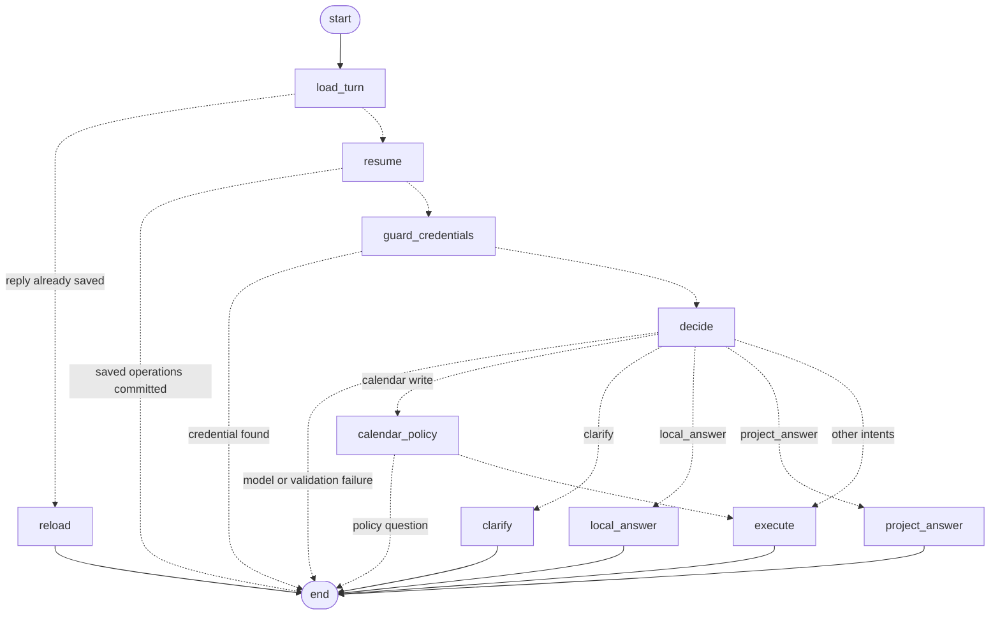

# The Contextual Router as a LangGraph Graph

**Status:** implemented. Every scripted turn in the deterministic suite has the same
result as before; see Evidence.

## Why

`ConversationRouterService.submit()` was a state machine written as early returns:
reload a replayed turn, resume saved operations, block a credential, make the routing
call, then branch on the decision's intent. Each branch was an `if` inside one long
method, and which steps a turn could pass through was visible only by reading it.

The turn now runs as a LangGraph `StateGraph`. Its steps are named nodes, its branches
are conditional edges, and the graph can be drawn from the compiled object. The
business rules the nodes call are the same methods as before.

The `langgraph` dependency returns. The redundancy cleanup removed it with the
Phase 1–3 capture graph, which the app no longer reached (see
[redundancy-cleanup.md](redundancy-cleanup.md)); this graph is the path every ordinary
chat turn takes.

## Boundary

The migration changes how a turn is sequenced, and nothing else:

- The public `submit()` signature and its `ConversationRouterTurn` result are
  unchanged. `ui.py` and the live acceptance runner are not touched.
- The prompts and the `ConversationDecision` schema are unchanged.
- The SQLite schema and storage are unchanged.
- No model call is added: a turn makes zero, one, or two calls, as before.
- **No checkpointer.** SQLite operations already make a turn restart-safe: a prepared
  operation is committed by the next submit of the same message. A LangGraph
  checkpoint would be a second recovery source that could disagree with the first.
- The router's validation and write methods (`_calendar_clarification_field`,
  `_execute`, `_answer_project`, and the rest) are called as they are, not refactored.
- Every existing test keeps its outcome, operations, and model-call count.

Because there is no checkpointer, LangGraph's `interrupt()` is not available. A
calendar deletion and a replaced decision or constraint still wait for review through
their stored `review` operations and the Chat buttons, as before.

## The graph

Dashed edges are conditional. `test_a_turn_runs_through_the_router_graph_without_a_checkpointer`
checks the node and edge sets against this drawing.

| Node | Model calls | What it does | Ends the turn when |
| --- | --- | --- | --- |
| `load_turn` | 0 | Saves or reloads the user message, selects the context window and candidates, and looks up a saved reply | — |
| `reload` | 0 | Returns the saved reply and operations (`reloaded`) | Always |
| `resume` | 0 | Commits operations a crash left prepared (`resumed`) | Any operation exists for the message |
| `guard_credentials` | 0 | The deterministic credential check (`blocked_credential`) | A credential is found |
| `decide` | 1 | The routing call and the candidate-ID check | The call or validation fails (`model_or_validation_failure`) |
| `calendar_policy` | 0 | Timezone, recurrence, date, duration, and start-time policy | A policy question is needed (`clarification_created`) |
| `clarify` | 0 | Replies with the model's question | Always |
| `local_answer` | 0 | Answers from the named SQLite rows or the lookup | Always |
| `project_answer` | 0 or 1 more | The project snapshot and the second call | Always |
| `execute` | 0 | Commits the one write, or replies for `reply_only` | Always |

The state (`RouterState`) holds the turn's inputs, what `load_turn` and `decide`
produced, the timing marks, and `turn`, which the finishing node sets. It lives only
for one `submit()`.

Errors keep the method's old boundaries. A `KeyError`, `ValueError`, or
`ValidationError` from a step after the decision becomes `write_or_dispatch_failure`;
in `execute` only the write is guarded, as before, so a reply that fails to save after
a committed write still raises. An error in `load_turn`, such as a reused message ID
with different content, propagates out of `submit()` unchanged.

## Evidence

**Turn-by-turn comparison.** Before the change, a script outside the repository
wrapped `submit()` and ran the whole suite, recording for every submit its outcome,
intent, model-call count, failure reason, reply, operation types and statuses, and
context size (IDs normalized). Two recordings of the old code were identical to each
other. The recording after the change is identical to them: 72 submits across 189
tests.

**New tests.** Two paths no test reached were covered first, against the old code,
and pass unchanged after it:

- `test_a_write_the_local_rules_refuse_is_a_dispatch_failure`: a tracker change in a
  conversation without a project.
- `test_a_reused_message_id_with_different_content_raises_before_the_model`.

A third, `test_a_turn_runs_through_the_router_graph_without_a_checkpointer`, checks
the graph's shape and that it has no checkpointer. The suite passes 190 tests.

**Cost.** Compiling the graph takes about 12 ms for each `ConversationRouterService`;
Chat builds one per turn, next to model calls of several seconds. Importing
`langgraph` adds about two seconds to a cold process start. The suite's run time
varied more between two runs on this machine than between the old and new code.

The live acceptance was not re-run: the prompt, schema, and calls are unchanged. The
next run records the router's new source fingerprint.

## Later

Not decided, and each needs its own design:

- **A checkpointer, and `interrupt()` for reviews.** Only if SQLite operations stop
  being the recovery source, so there is still exactly one.
- **A tool-using query step** for range questions such as `我下周有什么安排？`, which
  the router does not answer today. It would be a new node, and would add model
  calls.
